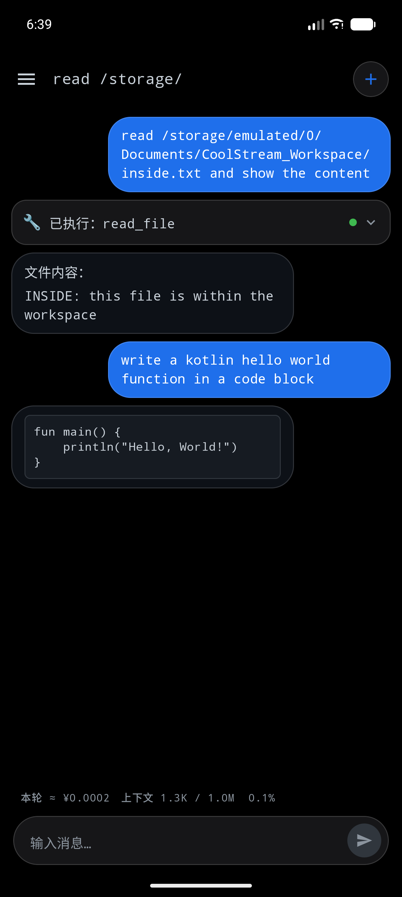
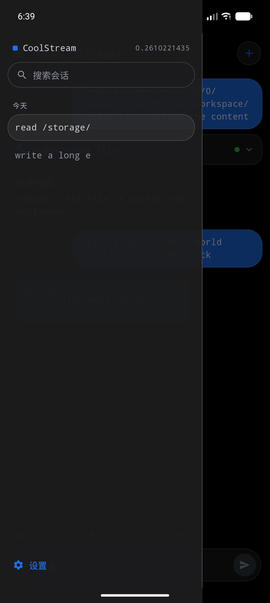
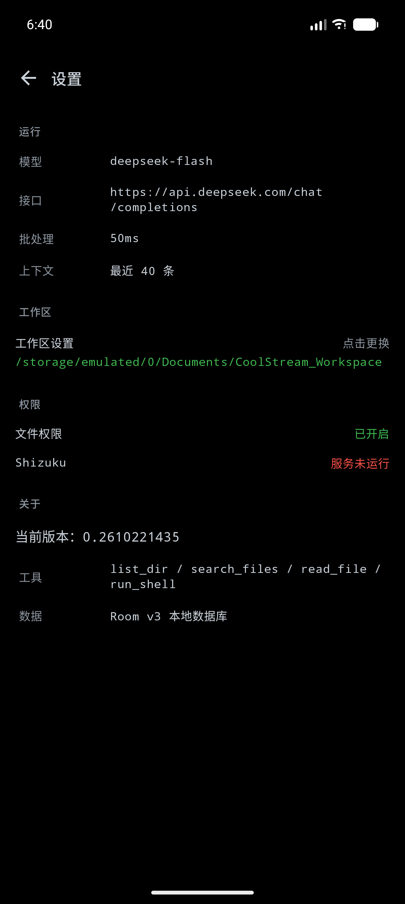

<div align="center">

# CoolStream

**A hand-crafted native Android client for DeepSeek — built to run cool.**


**English** | [简体中文](#简体中文)

</div>

---

# English

## TL;DR

CoolStream is a **fully native Jetpack Compose** Android client for the DeepSeek API. It exists because the WebView-based client I was using ran at **108% CPU** and **94.5 °C** while sitting idle in the background.

Replacing the WebView rendering layer with native Compose, plus a **50 ms batching** strategy for streaming output, cuts UI redraws by **93.6%** (911 fragments → 58 redraws), verified with reproducible A/B logs.

It also ships a real **agent loop** — tool calling, local execution, result feedback, and a second request — including `run_shell` via **Shizuku** escalation.

> **Read the [Limitations](#limitations) section before drawing conclusions.** This is an experiment log, not a product. The batching optimisation addresses *only* the UI redraw share of heat generation — not screen backlight, not the radio.

---

## Screenshots

Captured on a Pixel 9 Pro emulator (Android 17), dark theme.

| Chat — tool cards & code blocks | Navigation drawer | Settings |
|:---:|:---:|:---:|
|  |  |  |

The first shot is the part worth looking at: a **tool-call card** (`已执行: read_file`, green status dot) sitting between the user's request and the answer, plus a **fenced code block** rendered with a dark background and forced monospace. The bottom bar shows the per-turn cost estimate and context usage read straight from the API's `usage` field.

---

## What This Is

### The problem

I was using [`woaiys3/deepseek-harness-android-app`](https://github.com/woaiys3/deepseek-harness-android-app) — an Android packaging of DSH (DeepSeek Harness). To be precise about its architecture: it is **not** a "WebView wrapper". The outer shell is native Java and embeds a Node.js runtime for the DSH engine. But its **UI layer** is DSH's own web frontend, rendered by the system WebView.

That UI layer is where the cost lives. PerfDog sampling gave me two numbers:

| Metric | Measured |
|---|---:|
| CPU usage while backgrounded | **108%** (single-core basis) |
| CPU junction temperature | **94.5 °C** |

Both are abnormal. An app that is backgrounded and doing nothing visible should be deprioritised by the scheduler and land in the single digits. 94.5 °C is brushing against thermal throttling.

A WebView is, functionally, a complete browser engine. To render a chat screen it runs HTML/CSS/JS parsing, layout and compositing. For a workload that is essentially "text appearing one token at a time", that engine is enormously over-specified.

### The hypothesis

> If the main cost is WebView's rendering pipeline, then moving the UI layer to native Android views should reduce that cost substantially.

And more concretely, something measurable:

> During streaming, the UI does not need to repaint once per token. Coalescing updates into ~50 ms windows should cut redraw counts by an order of magnitude.

That is where the 50 ms batching came from.

### What it became

A single-activity, single-Kotlin-file app that now includes:

- A pure-black, GitHub/Codex-inspired UI with glassmorphism (no `Modifier.blur()`)
- Room persistence for sessions and messages
- A zero-dependency Markdown renderer
- A real tool-calling agent loop (`list_dir` / `search_files` / `read_file` / `write_file` / `replace_in_file` / `run_shell`)
- Shizuku escalation via AIDL `UserService`, with a regex command blacklist

---

## Benchmarks

### Method

**Single variable**: the batching interval, `FLUSH_INTERVAL_MS`.

- **Control**: `0L` — batching disabled, one redraw per fragment
- **Experiment**: `50L` — coalesce into ~50 ms windows

At the end of each stream the app logs one summary line:

```
stream done: total=<chars> (deltas=<fragments>, flushes=<actual redraws>, skipped=<null fragments>)
```

`deltas` is exactly "how many redraws would have happened without batching".

### Raw logs

**Control (`FLUSH_INTERVAL_MS = 0L`)**

```
stream done: total=1034 chars (deltas=643, flushes=643, skipped=2)
```

**Experiment (`FLUSH_INTERVAL_MS = 50L`)**

```
stream done: total=1458 chars (deltas=911, flushes=58, skipped=2)
```

### Comparison

| Metric | Control (0 ms) | Experiment (50 ms) | Change |
|---|---:|---:|---|
| Reply length (chars) | 1034 | 1458 | — |
| Stream fragments `deltas` | 643 | 911 | — |
| **Actual UI redraws `flushes`** | **643** | **58** | **−93.6%** |
| redraws / fragments | 1.000 | 0.0637 | — |
| Filtered null fragments `skipped` | 2 | 2 | — |

```
Redraw reduction (experiment) = (911 − 58) / 911 = 93.6%
Redraw reduction (control)    = (643 − 643) / 643 = 0%
```

### How to read these numbers

**The control proves the baseline.** 643 fragments → 643 redraws, a ratio of exactly 1.000. Without batching, the server dictates the redraw count.

**The experiment proves batching works.** 911 fragments triggered only 58 redraws. The theoretical ceiling is 20 redraws/second (1000 ms ÷ 50 ms), so 58 redraws implies the stream lasted **at least 2.9 seconds** — and that checks out against `deepseek-flash`'s observed throughput.

### Caveat

The two runs produced **different reply lengths** (1034 vs 1458 chars), because generation length cannot be fully controlled. The comparison is therefore a **ratio** (fragments → redraws), not an absolute count, so the 93.6% conclusion holds. A stricter methodology would fix the prompt and average multiple samples, or pin `max_tokens`.

---

## Core Features

| Area | What's there |
|---|---|
| **Streaming** | SSE parsed by hand, 50 ms batching, tail flush at end-of-stream |
| **Rendering** | In-place replacement of the last bubble only; Markdown rendered **once**, after `onDone` |
| **Persistence** | Room v3 — `sessions` + `messages` with `ON DELETE CASCADE`, enum `TypeConverter`, real `ALTER TABLE` migration |
| **Agent** | `tools` schema → streamed `tool_calls` reassembly → local execution → `role:"tool"` feedback → second request |
| **Tools** | `list_dir`, `search_files` (recursive, capped), `read_file` (5 MB cap + binary detection), `write_file` (2 MB cap, auto-`mkdirs`, `.bak` on overwrite), `replace_in_file` (exact-match, refuses ambiguity), `run_shell` |
| **Escalation** | Shizuku 13 via AIDL `UserService` (see below — `Shizuku.newProcess()` no longer exists) |
| **Safety** | 16-rule regex command blacklist applied **before** execution; workspace checks use `canonicalPath`, not `absolutePath` |
| **UI** | Pure black `#000000`, glassmorphism via translucent fills + 1 dp highlight strokes, monospace everywhere, 24 dp bubbles |

### Why Markdown is only rendered after `onDone`

Parsing Markdown on every 50 ms flush would defeat the entire optimisation. Instead:

- While `isStreaming`, the last AI bubble renders as **plain text**
- After `onDone` flips the flag, it is parsed **exactly once**, with the result cached by content
- Every other bubble is already final, so Compose skips it

The Markdown renderer is **~120 lines, zero dependencies** — it handles bold, `#`/`##`/`###` headings and fenced code blocks with a dark background and forced monospace. Pulling in a full CommonMark implementation for three features would have worked against the project's whole premise.

---

## Tech Stack

| Layer | Choice | Why |
|---|---|---|
| Language | **Kotlin 2.0** | First-class Android support |
| UI | **Jetpack Compose** (Material 3) | Declarative, no XML layouts |
| Network | **OkHttp 4.12.0** | One dependency; SSE parsed by hand |
| JSON | **`org.json`** | Ships with Android, zero deps |
| Persistence | **Room 2.6.1 + KSP** | Compile-time verified SQL |
| Escalation | **Shizuku 13.1.5** | Shell execution without root |

`minSdk 24` / `targetSdk 36`. The whole app is **one activity, one Kotlin file** — a deliberate choice, not an accident: fewer files means fewer places for a non-programmer to get lost.

---

## Build & Run

### Prerequisites

| Item | Version |
|---|---|
| Android Studio | 2026.2.1 (Rabbit) or newer |
| **Gradle JDK** | **21** (see the JDK warning below) |
| Android SDK | API 36 |
| Device | Android 7.0 (API 24)+, USB debugging enabled |

> ### ⚠️ Gradle JDK must be 21 (or 17–23), **not 25**
>
> Android Studio now bundles **JDK 25**, but **Gradle 8.13 only supports Java 8–23**. Building on 25 fails with:
>
> ```
> Unsupported class file major version 69
> ```
>
> Fix it in **Settings → Build, Execution, Deployment → Build Tools → Gradle → Gradle JDK**, and pick a real JDK 21. Note that **`org.gradle.java.home` in `gradle.properties` will not help for IDE sync** — Android Studio passes its own JDK through the Tooling API and overrides it.
>
> If you download a JDK through the IDE, **avoid Temurin / GraalVM / SapMachine** — their download URLs point at GitHub. Use **Azul Zulu** (`cdn.azul.com`), **Alibaba Dragonwell**, or **Amazon Corretto** (`corretto.aws`) instead.

### 1. Get an API key

Create one at [platform.deepseek.com](https://platform.deepseek.com). It looks like `sk-xxxxxxxx`.

### 2. Put it in `local.properties`

In the **project root** (next to `settings.gradle.kts`), append:

```properties
DEEPSEEK_API_KEY=sk-your-key-here
```

Format rules — this is where most people trip:

- No spaces around `=`
- No quotes around the value
- No semicolon, no `export`
- No trailing full-width space

`local.properties` is gitignored by the Android template. Verify with `git check-ignore -v local.properties`.

The key is injected via `buildConfigField`. **`buildFeatures { buildConfig = true }` is required** — newer AGP disables it by default.

### 3. Grant storage access (for `read_file` / `write_file` / `search_files` / `list_dir`)

`read_file` and friends read real filesystem paths, which needs "All files access":

1. The manifest already declares `MANAGE_EXTERNAL_STORAGE`
2. On first launch the app shows a prompt — tap **Go to settings**
3. Grant **All files access**

> On Xiaomi / HyperOS the toggle is **not** under "App permissions". It lives at
> **Settings → Apps → Permission manager → Special permissions → All files access**.
> The in-app button jumps straight there.

Reinstalling with `adb install -r` **resets this AppOp**. Re-grant it, or run:

```bash
adb shell appops set com.example.mychat MANAGE_EXTERNAL_STORAGE allow
```

### 4. Set up Shizuku (optional — only needed for `run_shell`)

Everything except `run_shell` works without Shizuku. To enable shell execution:

1. **Install Shizuku** — [Play Store](https://play.google.com/store/apps/details?id=moe.shizuku.privileged.api) or [GitHub releases](https://github.com/RikkaApps/Shizuku/releases)
2. **Start Shizuku** — enable Developer options → Wireless debugging, then start Shizuku *via wireless debugging* (or via root if you have it). Shizuku must show "Running".
3. **In CoolStream** — open the drawer (`☰`) → **Settings** → tap the **Shizuku** row → **Allow**
4. The app binds its `UserService` immediately and logs `Shizuku UserService 已连接`

Verify it worked by asking the agent to run `ls -la /sdcard`.

**How the escalation actually works** — this is worth stating because most tutorials are out of date:

> **`Shizuku.newProcess()` does not exist in Shizuku 13.** It is `private`, and `ShizukuRemoteProcess`'s constructor is package-private. Those snippets you'll find online are Shizuku 12.
>
> The only public path is **`Shizuku.bindUserService()` + AIDL**. Shizuku copies our `RemoteShellService` into a process running as **uid 2000 (shell)**, and the app talks to it over a Binder interface (`IRemoteShell.aidl`). See [DEVLOG.md](DEVLOG.md) for the full walkthrough.

### 5. Build

```bash
# Windows
set JAVA_HOME="C:\Program Files\Android\Android Studio\jbr"
gradlew.bat assembleDebug

# macOS / Linux
export JAVA_HOME="/Applications/Android Studio.app/Contents/jbr/Contents/Home"
./gradlew assembleDebug
```

Output: `app/build/outputs/apk/debug/app-debug.apk`.

### Troubleshooting

| Symptom | Cause | Fix |
|---|---|---|
| `Unsupported class file major version 69` | Gradle running on JDK 25 | Set Gradle JDK to 21 in the IDE |
| `Incompatible Gradle JVM version` | Same as above | Same |
| `Unresolved reference: BuildConfig` | `buildConfig = true` missing | Enable it and re-sync |
| `Unresolved reference: util` in `build.gradle.kts` | Wrote `java.util.Properties()` | `java` resolves to a Gradle extension — add `import java.util.Properties` at the top |
| `HTTP 401` | Bad / expired key, or stray spaces | Regenerate and paste carefully |
| `HTTP 404` | Incomplete URL | Must be `https://api.deepseek.com/chat/completions` |
| UI shows `nullnullnull` | Used `optString` for `content` | Use `opt()` + `as? String` — see DEVLOG |
| Agent says "I don't have permission" | No `tools` in the request, or no tool guidance in the system prompt | Both are required |
| `run_shell` says Shizuku isn't running | Shizuku app not started | Start Shizuku, then re-tap the Shizuku row |

---

## Honest Disclosure: How This Was Built

**This matters more than the benchmark, because it determines how you should read this repository.**

This project was built by a **second-year undergraduate with no programming background** — a **nursing** major who scored **0** on the C programming course exam. Two AI tools were used: **DeepSeek (web)** and **WorkBuddy (international)**.

The division of labour is explicit:

| Who | Did what |
|---|---|
| **Author (jianling17)** | Defined the problem, chose the direction, **designed the A/B experiment**, collected and analysed the logs, made the trade-off decisions, judged whether the AI's conclusions held up |
| **AI tools** | All Kotlin / Compose implementation, bug localisation and fixes, documentation drafting |

**This is not independent development. It is a record of AI-assisted solo development.**

The author **cannot independently read or modify this codebase**. That has real consequences for maintainability, security and long-term iteration — see [Limitations](#limitations). It is written down because "how far can a non-programmer get with AI, and where does the wall actually sit" seemed worth documenting reproducibly.

---

## Limitations

**This section is more important than the benchmark.** I would rather under-claim than mislead.

**Rendering is not the main source of phone heat.** Screen backlight and the radio dominate; the SoC's UI redraw share is a fraction. Batching optimises that fraction only.

**The realistic gain is 1–3 °C, not "from hot to cold".** That magnitude is easily swamped by ambient temperature variation — you will not feel it. **This repository publishes no temperature measurement**, because my test conditions cannot produce a trustworthy one, and a pretty but unreliable number is worse than none.

**The two runs used different reply lengths** (1034 vs 1458 chars). The comparison is a ratio, so the conclusion holds, but a stricter method would fix the prompt and average samples.

**Single device only** — Xiaomi 24117RK2CC / Android 16 / Snapdragon 8-series (pm8550). Do not extrapolate.

**`flushes` counts redraws, not watts.** Going from "93.6% fewer redraws" to "X °C cooler" crosses scheduler, DVFS and thermal design. This project proves the former, not the latter.

**The API key is not secure.** `buildConfigField` compiles the key into the APK; anyone with the APK can extract it. A server-side proxy is the correct fix and is not implemented. **Do not distribute your APK.**

**Tool cards are not persisted** — they live in memory and vanish on restart (the final answer is saved).

**Rotation loses state** — no ViewModel yet.

**The shell blacklist is a safety net, not a security boundary.** Shell is Turing-complete; `r''m -rf /`, `echo ... | base64 -d | sh` and similar all get through. It stops the model from *casually* issuing destructive commands. It does not stop a determined attacker.

**Unaudited code.** No code review was possible, because the author cannot read diffs. **Not suitable for production or any serious use.** If you want to build on these ideas, have an experienced Android developer reimplement them.

---

## Roadmap

- [x] Minimal chat UI
- [x] DeepSeek streaming API
- [x] 50 ms batching + in-place bubble update
- [x] Log-based quantitative validation
- [x] Multi-turn context (last 40 messages)
- [x] Room persistence (sessions + messages, v3)
- [x] Geek-style dual theme + glassmorphism + drawer
- [x] Sidebar state isolation (fixes drawer jank)
- [x] Markdown rendering + code blocks (zero-dependency)
- [x] Tool calling agent loop
- [x] Shizuku escalation + `run_shell` with blacklist
- [x] `write_file` (workspace-checked, auto-`mkdirs`, `.bak` before overwrite)
- [x] `replace_in_file` (surgical edits; refuses ambiguous matches; 16 JVM unit tests)
- [ ] Long-press to delete a session
- [ ] ViewModel (survive rotation)
- [ ] Persist tool cards
- [ ] Signed release APK
- [ ] Server-side key proxy
- [ ] Controlled temperature measurement

---

## License

Personal project, no open-source license specified yet. Attribution appreciated if you borrow ideas or snippets.

---

<div align="center">

**English** | [简体中文](#简体中文)

</div>

---

# 简体中文

## 一句话总结

CoolStream 是一个**完全原生 Jetpack Compose** 实现的 DeepSeek 安卓客户端。做它的起因很具体：我之前用的 WebView 客户端，**退到后台什么都不做**的情况下，CPU 占用 **108%**、CPU 结温 **94.5 ℃**。

把渲染层换成原生 Compose，再对流式输出做 **50ms 批处理**，UI 重绘次数下降 **93.6%**（911 个碎片 → 58 次刷新），有可复现的 A/B 日志为证。

它还带一套**真实的 Agent 闭环**——工具调用、本地执行、结果回填、二次请求——其中包括通过 **Shizuku** 提权执行的 `run_shell`。

> **下结论前请先看[「说明与局限」](#说明与局限)。** 这是一份实验记录，不是产品。批处理优化的只是「UI 重绘」这一块，不涉及屏幕背光，也不涉及射频。

---

## 界面截图

在 Pixel 9 Pro 模拟器（Android 17）上截取，深色主题。

| 聊天 —— 工具卡片与代码块 | 侧边栏 | 设置页 |
|:---:|:---:|:---:|
|  |  |  |

第一张是重点：用户提问和 AI 回答之间插着一张**工具调用卡片**（`已执行: read_file`，右侧绿点），下面是**围栏代码块**——深色底 + 强制等宽字体。底部那一行是每轮费用估算和上下文用量，数据直接来自 API 返回的 `usage` 字段。

---

## 这是什么

### 问题

我原来用的是 [`woaiys3/deepseek-harness-android-app`](https://github.com/woaiys3/deepseek-harness-android-app)——DSH（DeepSeek Harness）的安卓打包版。它的架构要说准：**它不是「WebView 套壳」**，外层是原生 Java 壳、内置 Node.js 跑 DSH 引擎；但它的**界面层**是 DSH 自己的 Web 前端，由系统 WebView 渲染。

开销就在这一层。我用 PerfDog 采样拿到两个数字：

| 指标 | 实测 |
|---|---:|
| 退到后台时的 CPU 占用 | **108%（单核口径）** |
| CPU 结温 | **94.5 ℃** |

两条都反常。一个已经退到后台、界面上什么都不做的 App，正常应该被系统降优先级、限流，占用落在个位数百分比；而 94.5 ℃ 已经贴着热保护阈值了。

WebView 本质上是一个完整的浏览器内核。为了渲染一个聊天界面，它要跑一整套 HTML / CSS / JS 引擎，加上排版和合成。对「文字一条一条往外蹦」这种场景来说，这套引擎太重了。

### 假设

> 如果发热的主要来源是 WebView 的渲染开销，那么把界面层换成安卓原生 UI，这块开销就应该显著下降。

再收敛成一条可测的：

> 流式输出时，UI 不需要每来一个碎片就刷新一次。攒够 50ms 刷一次，重绘次数应该能降一个数量级。

这就是 **50ms 批处理**的来历。

### 最终形态

一个 Activity、一个 Kotlin 文件的 App，现在包含：

- 纯黑 + GitHub / Codex 风格的毛玻璃 UI（**不用 `Modifier.blur()`**）
- Room 持久化（会话 + 消息）
- 零依赖的 Markdown 渲染器
- 真实的 Tool Calling 闭环（`list_dir` / `search_files` / `read_file` / `write_file` / `replace_in_file` / `run_shell`）
- Shizuku 提权（AIDL `UserService`）+ 正则命令黑名单

---

## 实测数据

### 测试方法

**唯一变量**：批处理间隔 `FLUSH_INTERVAL_MS`。

- **对照组**：`0L`——关闭批处理，每个碎片都刷
- **实验组**：`50L`——攒够 50ms 刷一次

每次流结束，App 输出一行汇总日志：

```
stream done: total=<总字数> (deltas=<碎片数>, flushes=<实际刷新次数>, skipped=<空碎片数>)
```

`deltas` 就是「不做批处理时要刷多少次」。

### 原始日志

**对照组（`FLUSH_INTERVAL_MS = 0L`）**

```
stream done: total=1034 chars (deltas=643, flushes=643, skipped=2)
```

**实验组（`FLUSH_INTERVAL_MS = 50L`）**

```
stream done: total=1458 chars (deltas=911, flushes=58, skipped=2)
```

### 对比

| 指标 | 对照组（0ms） | 实验组（50ms） | 变化 |
|---|---:|---:|---|
| 回复总字数 | 1034 | 1458 | — |
| 流式碎片 `deltas` | 643 | 911 | — |
| **实际 UI 刷新 `flushes`** | **643** | **58** | **↓ 93.6%** |
| 刷新 / 碎片 比值 | 1.000 | 0.0637 | — |
| 被过滤的空碎片 `skipped` | 2 | 2 | — |

```
实验组减少的无效重绘 = (911 − 58) / 911 = 93.6%
对照组减少的无效重绘 = (643 − 643) / 643 = 0%
```

### 怎么理解这组数字

**第一，对照组证明了基线。** 643 个碎片对应 643 次刷新，比值正好 1.000。没有批处理时，**服务端推多少片，界面就重绘多少次**。

**第二，实验组证明了批处理生效。** 911 个碎片只触发 58 次刷新。理论上限是每秒 20 次（1000ms ÷ 50ms），所以 58 次刷新意味着这段流至少持续了 **2.9 秒**——和 `deepseek-flash` 的实际速度相符。

### 不足

两组回复长度不同（1034 / 1458 字），因为生成长度无法完全控制。这里比较的是**比例**（碎片 → 刷新的压缩比），不是绝对次数，所以 93.6% 这个结论不受影响；更严谨的做法是固定提示词、多次采样取平均，或者用 `max_tokens` 锁死长度。

---

## 核心特性

| 板块 | 实现 |
|---|---|
| **流式** | 手写 SSE 解析、50ms 批处理、流结束尾部补偿 |
| **渲染** | 只原地替换最后一条气泡；Markdown **只在 `onDone` 之后渲染一次** |
| **持久化** | Room v3——`sessions` + `messages`（`ON DELETE CASCADE`）、枚举 `TypeConverter`、正经 `ALTER TABLE` 迁移 |
| **Agent** | `tools` 清单 → 流式 `tool_calls` 分片重组 → 本地执行 → `role:"tool"` 回填 → 二次请求 |
| **工具** | `list_dir`、`search_files`（递归 + 三重上限）、`read_file`（5MB 上限 + 二进制探测）、`write_file`（2MB 上限、自动建父目录、覆盖前留 `.bak`）、`replace_in_file`（逐字匹配、拒绝歧义）、`run_shell` |
| **提权** | Shizuku 13，走 AIDL `UserService`（见下——`Shizuku.newProcess()` 已经不存在了） |
| **安全** | 16 条正则黑名单，在**执行之前**拦截；工作区判断用 `canonicalPath` 而不是 `absolutePath` |
| **UI** | 纯黑 `#000000`、半透明底 + 1dp 高光边框的毛玻璃、全篇等宽、24dp 气泡 |

### 为什么 Markdown 只在 `onDone` 之后渲染

如果每个 50ms 的 flush 都解析一遍 Markdown，整个优化就白做了。所以：

- `isStreaming` 期间，最后一条 AI 气泡走**纯文本**
- `onDone` 把标志位翻回去之后，**只解析一次**，并按内容缓存结果
- 其余气泡早已定稿，Compose 直接跳过

渲染器是 **120 行零依赖**的实现——支持粗体、`#`/`##`/`###` 标题、围栏代码块（深色底 + 强制等宽）。为了三个特性拖进一整套 CommonMark，反而与本项目的初衷相悖。

---

## 技术栈

| 层 | 选型 | 为什么 |
|---|---|---|
| 语言 | **Kotlin 2.0** | Android 官方首选 |
| UI | **Jetpack Compose**（Material 3） | 声明式，没有 XML 布局 |
| 网络 | **OkHttp 4.12.0** | 一条依赖；SSE 手写解析 |
| JSON | **`org.json`** | 平台自带，零依赖 |
| 持久化 | **Room 2.6.1 + KSP** | 编译期校验 SQL |
| 提权 | **Shizuku 13.1.5** | 免 root 拿到 shell 权限 |

`minSdk 24` / `targetSdk 36`。整个 App 是**一个 Activity、一个 Kotlin 文件**——这是刻意选择，不是省事：文件越少，零基础的人越不容易迷路。

---

## 编译与运行

### 环境要求

| 项目 | 版本 |
|---|---|
| Android Studio | 2026.2.1（Rabbit）或更新 |
| **Gradle JDK** | **21**（注意下面的 JDK 警告） |
| Android SDK | API 36 |
| 设备 | Android 7.0（API 24）以上，开启 USB 调试 |

> ### ⚠️ Gradle JDK 必须是 21（或 17~23），**不能是 25**
>
> Android Studio 现在自带 **JDK 25**，而 **Gradle 8.13 只支持 Java 8~23**。用 25 构建会报：
>
> ```
> Unsupported class file major version 69
> ```
>
> 改法：**Settings → Build, Execution, Deployment → Build Tools → Gradle → Gradle JDK**，选一个真实注册的 JDK 21。
> 注意 **在 `gradle.properties` 里写 `org.gradle.java.home` 对 IDE 同步无效**——AS 通过 Tooling API 塞自己的 JDK，会覆盖它。
>
> 如果让 AS 下载 JDK，**别选 Temurin / GraalVM / SapMachine**——它们走 GitHub 下载。用 **Azul Zulu**（`cdn.azul.com`）、**Alibaba Dragonwell**、**Amazon Corretto**（`corretto.aws`）更稳。

### 1. 申请 API Key

去 [platform.deepseek.com](https://platform.deepseek.com) 申请，形如 `sk-xxxxxxxx`。

### 2. 写进 `local.properties`

在**项目根目录**（和 `settings.gradle.kts` 同层）追加一行：

```properties
DEEPSEEK_API_KEY=sk-你的Key
```

格式要求（最容易出错的地方）：

- 等号两边**不加空格**
- 值**不加引号**
- 不加分号，不写 `export`
- 行尾不要有全角空格

`local.properties` 是 Android 模板自带的 gitignore 项。可以自己验证：`git check-ignore -v local.properties`。

Key 通过 `buildConfigField` 注入。**必须开 `buildFeatures { buildConfig = true }`**——新版 AGP 默认关闭。

### 3. 授予文件访问权限（`read_file` / `write_file` / `search_files` / `list_dir` 需要）

要读真实文件路径，需要「所有文件访问权限」：

1. Manifest 里已声明 `MANAGE_EXTERNAL_STORAGE`
2. 首次启动会弹窗提示，点 **去开启**
3. 打开 **所有文件访问权限**

> 小米 / HyperOS 上这个开关**不在「应用权限」页**，而在：
> **设置 → 应用设置 → 权限管理 → 特殊权限 → 所有文件访问权限**。
> App 里那个按钮会直接跳过去。

用 `adb install -r` 覆盖安装**会把这项 AppOp 重置**。重新授予，或者执行：

```bash
adb shell appops set com.example.mychat MANAGE_EXTERNAL_STORAGE allow
```

### 4. 配置 Shizuku（可选，只有 `run_shell` 需要）

除了 `run_shell`，其它所有功能都不需要 Shizuku。要启用 shell 执行：

1. **装 Shizuku**——[Play Store](https://play.google.com/store/apps/details?id=moe.shizuku.privileged.api) 或 [GitHub releases](https://github.com/RikkaApps/Shizuku/releases)
2. **启动 Shizuku**——打开开发者选项 → 无线调试，然后**通过无线调试**启动 Shizuku（有 root 也可以走 root）。Shizuku 显示「正在运行」才算成功。
3. **在 CoolStream 里**——打开抽屉（`☰`）→ **设置** → 点 **Shizuku** 那一行 → **允许**
4. App 会立刻绑定 `UserService`，日志里出现 `Shizuku UserService 已连接`

验证：让 Agent 执行 `ls -la /sdcard`。

**提权到底怎么实现的——这里必须说清，因为网上教程都是旧的：**

> **`Shizuku.newProcess()` 在 Shizuku 13 里已经不存在了。** 它是 `private`，`ShizukuRemoteProcess` 的构造器也是包内私有。网上那些示例是 Shizuku 12 的写法。
>
> 唯一公开的路子是 **`Shizuku.bindUserService()` + AIDL**：Shizuku 把我们的 `RemoteShellService` 复制到 **uid 2000（shell）**的进程里运行，App 通过 Binder 接口（`IRemoteShell.aidl`）把命令丢过去。完整过程见 [DEVLOG.md](DEVLOG.md)。

### 5. 编译

```bash
# Windows
set JAVA_HOME="C:\Program Files\Android\Android Studio\jbr"
gradlew.bat assembleDebug

# macOS / Linux
export JAVA_HOME="/Applications/Android Studio.app/Contents/jbr/Contents/Home"
./gradlew assembleDebug
```

产物：`app/build/outputs/apk/debug/app-debug.apk`。

### 常见问题

| 现象 | 原因 | 解法 |
|---|---|---|
| `Unsupported class file major version 69` | Gradle 跑在 JDK 25 上 | 在 IDE 里把 Gradle JDK 设成 21 |
| `Incompatible Gradle JVM version` | 同上 | 同上 |
| `Unresolved reference: BuildConfig` | 没开 `buildConfig = true` | 打开后重新 Sync |
| `build.gradle.kts` 里 `Unresolved reference: util` | 写了 `java.util.Properties()` | `java` 会被解析成 Gradle 扩展，必须在文件顶部 `import java.util.Properties` |
| `HTTP 401` | Key 无效 / 过期 / 多了空格 | 重新生成，注意粘贴 |
| `HTTP 404` | 接口地址不完整 | 必须是 `https://api.deepseek.com/chat/completions` |
| 界面出现 `nullnullnull` | 用 `optString` 取 `content` | 用 `opt()` + `as? String`，详见 DEVLOG |
| Agent 说「我没有权限」 | 请求里没有 `tools`，或提示词没写工具 | 两者都必须有 |
| `run_shell` 说 Shizuku 没运行 | Shizuku App 没启动 | 启动 Shizuku，再点一次 Shizuku 那一行 |

---

## 关于开发方式

**这一条比性能数字更重要，因为它决定了你应该怎么看待这个仓库。**

本项目由一位**没有编程基础的大二学生**完成（**护理学专业**，C 语言课程考试成绩 0 分）。开发过程用了两个 AI 工具：**DeepSeek 网页端** 和 **WorkBuddy 国际版**。

分工是明确的：

| 谁 | 做了什么 |
|---|---|
| **作者（jianling17）** | 提出需求、确定方向、**设计 A/B 对照实验**、采集与分析日志、做取舍决策、判断 AI 的结论是否站得住 |
| **AI 工具** | 全部 Kotlin / Compose 代码实现、Bug 定位与修复、文档撰写辅助 |

**这不是传统意义上的独立开发，而是一次「AI 辅助个人开发」的实践记录。**

作者**不具备独立阅读和修改本项目代码的能力**，这对可维护性、安全性和长期迭代有实质影响，详见[「说明与局限」](#说明与局限)。写下来是因为：「一个非程序员借助 AI 能把想法做到什么程度、边界在哪里」这件事本身值得留一份可复现的材料。

---

## 说明与局限

**这一节比上面的性能数字更重要。** 我不想让这个项目看起来像在吹牛。

**渲染不是手机发热的唯一原因，甚至不是主要原因。** 屏幕背光和射频才是大头，SoC 的计算（含 UI 重绘）只占一部分。批处理优化的就是这一部分。

**预期收益是 1~3℃ 量级，不是「从烫手变冰凉」。** 这个幅度在环境温度波动面前很容易被淹没，你很难用体感分辨。**本仓库没有提供温度实测数字**——手机温度测量受环境影响太大，我目前的测试条件不足以得出可信数字，**与其给一个不可信的好看数字，不如不给**。

**两组数据的回复长度不同**（1034 / 1458 字）。这里比的是比例，结论不受影响，但方法论上算个瑕疵。

**只在单台设备上测过**——小米 24117RK2CC / Android 16 / 骁龙 8 系（pm8550）。不能直接外推到其他设备。

**`flushes` 是重绘次数，不是功耗。** 从「重绘减少 93.6%」到「温度下降 X℃」之间，还隔着调度器、DVFS、散热设计。本项目只证明了前一件事。

**API Key 不安全。** `buildConfigField` 会把 Key 编进 APK，反编译能拿到。真正的解法是加后端代理，本项目没做。**所以不要把 APK 分发给别人。**

**工具卡片没有入库**——只存在内存里，重启 App 后卡片消失（最终回答在库里）。

**旋转屏幕会丢状态**——还没上 ViewModel。

**命令黑名单是安全网，不是安全边界。** shell 是图灵完备的，`r''m -rf /`、`echo ... | base64 -d | sh` 这类都能绕过去。它能拦住模型「顺手」发起的破坏性操作，拦不住蓄意攻击。

**代码未经审查。** 作者读不懂 diff，无法做 code review。**不适合生产环境或任何严肃用途。** 想把这个思路用到真实场景，建议请具备 Android 开发能力的人重新实现。

---

## 后续计划

- [x] 最小可用聊天界面
- [x] 接入 DeepSeek 流式 API
- [x] 50ms 批处理 + 只更新最后一个气泡
- [x] 用日志量化验证批处理效果
- [x] 多轮上下文（最近 40 条）
- [x] Room 持久化（会话 + 消息，v3）
- [x] 极客风双皮肤 + 毛玻璃 + 抽屉式布局
- [x] 侧边栏状态隔离（消除抽屉卡顿）
- [x] Markdown 渲染 + 代码块（零依赖）
- [x] Tool Calling 闭环
- [x] Shizuku 提权 + `run_shell`（含黑名单）
- [x] `write_file`（工作区校验 + 自动建父目录 + 覆盖前留 `.bak`）
- [x] `replace_in_file`（局部精准修改；匹配到多处直接拒绝；16 条 JVM 单元测试）
- [ ] 会话长按删除
- [ ] ViewModel（旋转不丢状态）
- [ ] 工具卡片持久化
- [ ] 签名打包 release APK
- [ ] 服务端代理藏 Key
- [ ] 控制变量后的温度实测

---

## 许可

个人项目，暂未指定开源许可。引用其中的思路或代码片段，注明出处即可。

---

<div align="center">

[English](#english) | **简体中文**

*一份实验记录，不是产品。*

</div>
